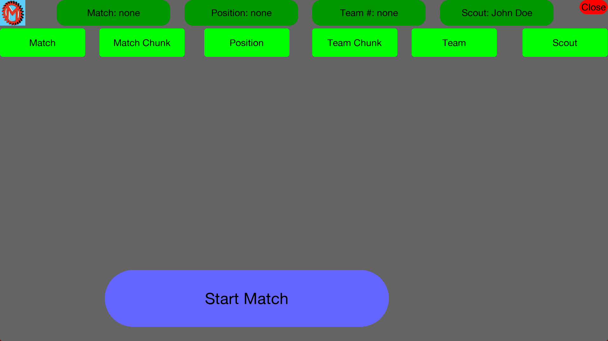
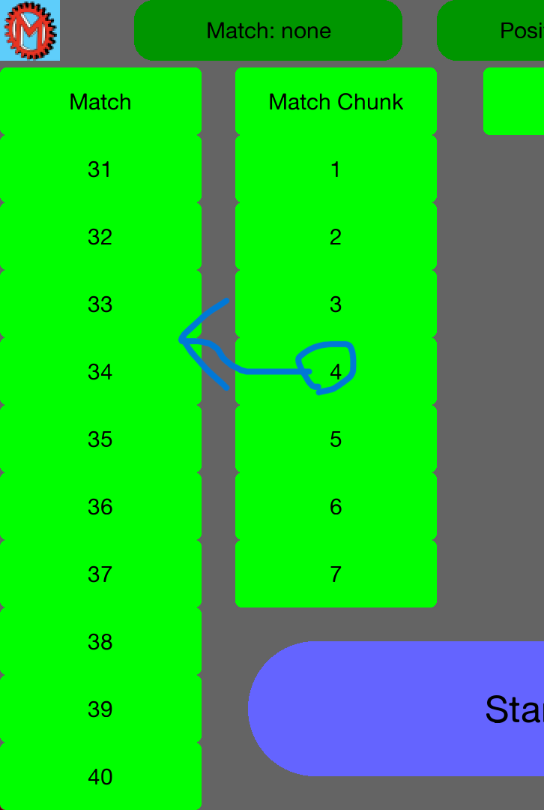
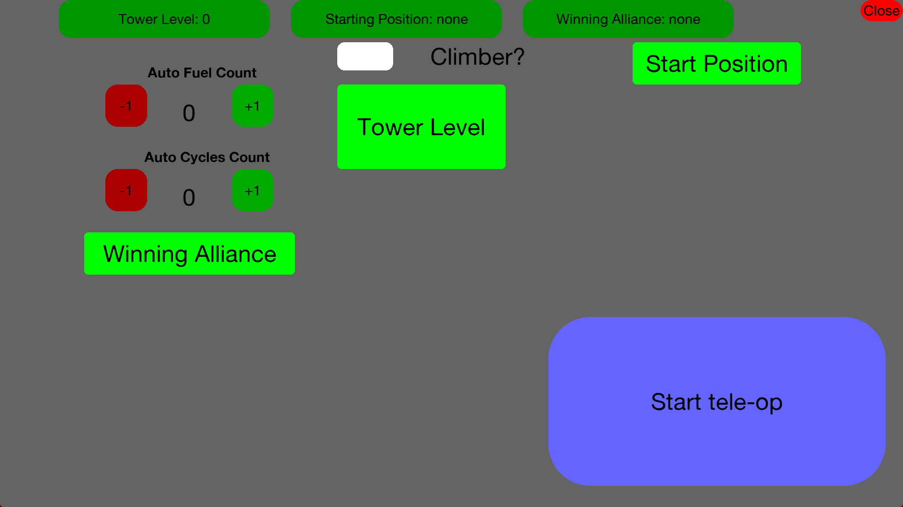
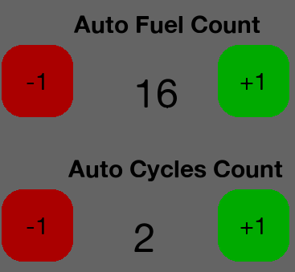
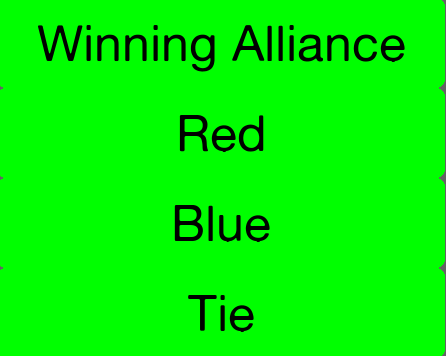

Scouting app for the 2026/2027 FRC season.
Currently broken as of [this release](https://github.com/frc8724/2027-Scouting/releases/tag/Broken).
- Made in Pygame
- Android support (partially).
- Dropdown classes, no text inputs for ease-of-use.

# HOW TO RUN
Extract the folder for the latest release, then double-click `desktop.exe` (the one with the Mayhem gear logo).
That's it!

# USAGE
The app is meant to be used while scouting a 2026 FIRST Robotics Competition competition.
## MATCH SETUP (Main menu)


The lime green buttons are dropdowns, click them to open and select a value.
The value for each pre-match value is displayed in the darker green rectangles at the top of the screen, as shown here.


The "Match Chunk" and "Team Chunk" dropdowns are solely for picking a set, or "chunk", of teams and matches so they all fit on the screen.
For example, selecting 4 in the Match Chunk dropdown lets you pick from matches 31-40, as shown below:


## AUTO PERIOD


Use the buttons labeled `+1` and `-1` to count Fuel scored and cycles of intaking Fuel to the center.


The white square next to the text saying `Climber?` is a check box.
Click it if the robot climbed in auto, as well as selecting the level it climbed to.


Make sure to select the Alliance that won the auto period (scored the most points), as this will be important in the tele-op section.

# BUILD INSTRUCTIONS
# WINDOWS
1. Install Git from https://git-scm.com
2. Clone repo
```
git clone https://github.com/frc8724/2027-Scouting
```
3. Install Python from https://python.org (tested on 3.10.11 and newer)
4. Install dependencies with pip
```
pip install pygame
pip install pyinstaller
```
5. Navigate to where you cloned the repo
6. Build with PyInstaller
```
pyinstaller desktop.py --hide-console minimize-early -F --icon "assets/logo.ico"
```
7. Copy `/assets` into the `/dist` folder
8. Double-click `desktop.exe` to run!
# ANDROID
## Option 1: Build it yourself
1. Follow the [Buildozer setup instructions](https://buildozer.readthedocs.io/en/stable/installation/]
2. Install Python dependencies
```
pip install pygame
```
3. Rename GUI file to main.py
```
mv phonePortrait.py main.py
```
Or if compiling for an Android tablet:
```
mv ipad.py main.py
```
4. Run Buildozer
```
buildozer android debug
```
## Option 2: Get a pre-built APK
The APK for the latest commit can always be downloaded from [the Actions tab](https://github.com/frc8724/2027-Scouting/actions)
